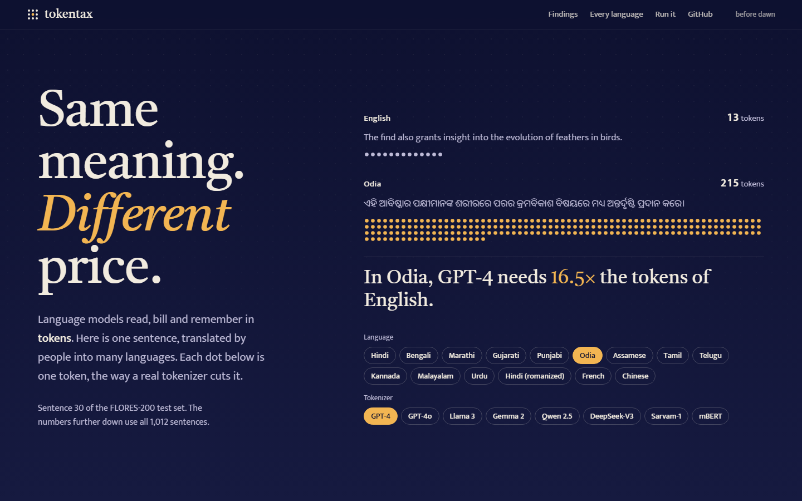
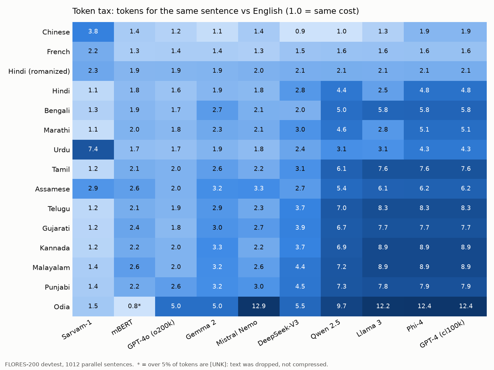
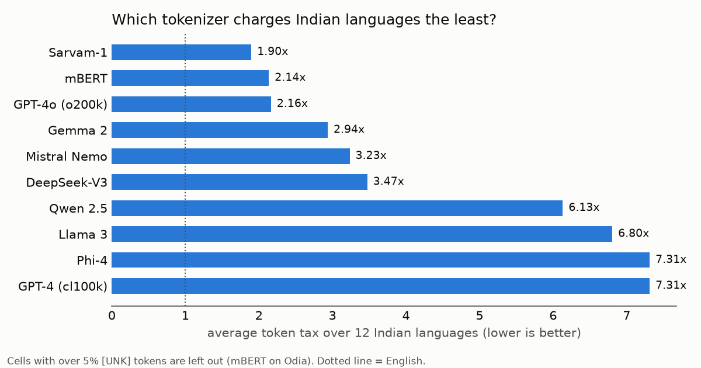

# tokentax

**The same content can take nearly 13× as many tokens in an Indian language as in English.** tokentax measures this "token tax" for 15 languages across 10 real LLM tokenizers. It uses FLORES-200, where every sentence is a human translation of the same English text.

More tokens means a bigger API bill, slower generation and a smaller usable context window, for the same meaning.

**[Open the interactive site →](https://naman-verma-02.github.io/tokentax/)**

[](https://naman-verma-02.github.io/tokentax/)



## Findings

All numbers come from [`results/results.csv`](results/results.csv) (FLORES-200 `devtest`, 1012 sentences per language). Rerun with `tokentax bench`.

1. **The GPT-4 → GPT-4o tokenizer change was a big price cut for India.** Hindi went from 4.76× English (cl100k) to 1.57× (o200k). Tamil went from 7.64× to 1.98×. In a 128k context, GPT-4's tokenizer fits 623 Tamil sentences; GPT-4o's fits 2,434.
2. **Llama 3 helped Hindi and no other Indian language.** Llama 3 took GPT-4's vocabulary and added 28k tokens. Hindi dropped from 4.76× to 2.52× and Marathi from 5.06× to 2.80×, since both use the same Devanagari script. Tamil (7.65×), Telugu (8.29×) and Kannada (8.86×) did not change at all.
3. **Odia is the most expensive language almost everywhere.** It costs 12.9× on Mistral Nemo, 12.4× on Phi-4 and GPT-4, 12.2× on Llama 3 and 9.7× on Qwen 2.5. Only Sarvam-1 (1.46×) prices it like the other Indian languages.
4. **An Indic-trained tokenizer wins on its own languages and loses everywhere else.** Sarvam-1 averages 1.24× on the 10 Indian languages it was built for (never above 1.47×). It charges 7.39× on Urdu and 2.92× on Assamese (neither is in its supported list), 3.82× on Chinese, and its English also takes 17% more tokens than GPT-4o's. A low *tax* alone does not mean a cheap tokenizer.
5. **Bigger vocabulary ≠ fairer.** Across tokenizers, vocabulary size and average Indic tax have a Spearman correlation of −0.15. What matters is which languages the vocabulary was trained on, not how big it is.
6. **Romanized Hindi costs about 2× on every tokenizer (1.88–2.30).** For old tokenizers this is cheaper than Devanagari (GPT-4: 2.13× vs 4.76×). For GPT-4o and Sarvam-1 it is more expensive than the native script. Typing Hinglish only saves money on tokenizers that never learned Devanagari.
7. **A "cheap" result can be lost text.** mBERT scores Odia at 0.78×, cheaper than English, because 86% of its Odia tokens are `[UNK]`: the text was thrown away. tokentax tracks the `[UNK]` rate for every cell and flags this (dashed cells, `*` in the chart).



Every tax has a 95% bootstrap interval (resampling sentences, 1000 draws); the widest interval in the whole table spans 0.34×. The differences above are far bigger than the noise.

## Try it on your own text

```bash
pip install git+https://github.com/NAMAN-VERMA-02/tokentax
tokentax "मेरा नाम नमन है" --vs "my name is naman"
```

```
tokenizer       tokens  vs   tax
GPT-4 (cl100k)      15     5  3.00x
GPT-4o (o200k)       6     4  1.50x
Llama 3              9     5  1.80x
Gemma 2              6     4  1.50x
Qwen 2.5            15     5  3.00x
DeepSeek-V3         10     5  2.00x
Mistral Nemo         6     5  1.20x
Phi-4               15     5  3.00x
Sarvam-1             5     6  0.83x
mBERT                6     4  1.50x
```

Use `-t sarvam,gpt-4o` to pick tokenizers by any unique part of their name. `tokentax bench` reruns the full study and redraws the charts. Only tokenizer files are downloaded (a few MB each), never model weights, so it runs on any laptop CPU in a couple of minutes.

## How it works

```
FLORES-200 devtest ──► 1012 sentences × 16 languages (same meaning, human-translated)
        │
        ▼
for each tokenizer (tiktoken or a Hugging Face tokenizer.json):
    tokens(lang)  = Σ len(encode(sentence))        no BOS/CLS special tokens
    tax           = tokens(lang) / tokens(English)  ratio of totals, not mean of ratios
    95% CI        = bootstrap over sentence pairs (1000 draws, fixed seed)
    unk_rate      = share of [UNK] tokens           catches tokenizers that drop text
    byte_premium  = UTF-8 bytes(lang) / bytes(English)  the script's own cost, tokenizer-free
        │
        ▼
results/results.csv ──► heatmap.png, by_tokenizer.png, docs/results.json (website)
```

Why each choice:

- **Ratio of totals.** A mean of per-sentence ratios lets a few very short sentences dominate the average. Summing tokens first gives the cost of the whole text.
- **Byte premium as a control.** Devanagari, Tamil and other Brahmic scripts take 3 UTF-8 bytes per character, so Indian languages cost about 2.5–3.2× English in bytes before any tokenizer sees them. A byte-level tokenizer that learned nothing about a script lands near that number. A tax far *above* it (GPT-4 on Odia: 12.4× tax vs 2.74× bytes) means the tokenizer is splitting characters into byte pieces.
- **`[UNK]` rate.** Without it, a tokenizer that maps unknown scripts to a single `[UNK]` looks like the cheapest one.

The code is about 360 lines in five files: [`data.py`](tokentax/data.py), [`tokenizers.py`](tokentax/tokenizers.py), [`measure.py`](tokentax/measure.py), [`plots.py`](tokentax/plots.py) and [`cli.py`](tokentax/cli.py).

## Add a tokenizer or a language

It's one line each.

```python
# tokentax/tokenizers.py
TOKENIZERS = {
    ...
    "Mistral Nemo": ("hf", "mistralai/Mistral-Nemo-Base-2407"),   # any HF repo with a tokenizer.json
}

# tokentax/data.py
LANGUAGES = {
    ...
    "Nepali": "npi_Deva",   # any of the 200 FLORES codes
}
```

Then `tokentax bench` and open a PR with the new CSV. See [CONTRIBUTING.md](CONTRIBUTING.md).

## Limitations

- **FLORES is formal text** (Wikinews, Wikivoyage, Wikibooks). Chat messages, code-mixed text and social media will tokenize differently.
- **Romanized Hindi is machine-transliterated** (ITRANS, lowercased). It keeps schwas real typists drop ("aba" for "ab"), so real Hinglish is probably a bit shorter.
- **Tokens are not quality.** A tokenizer with a low tax can still sit in front of a model that writes poor Tamil.
- **No prices.** Prices change every few months; token counts don't. Multiply by your provider's current price.
- **Tokenizers, not models.** "Llama 3" means the tokenizer shared by Llama 3.x, loaded from an ungated mirror (`unsloth/Llama-3.2-1B`). The same goes for Gemma 2.

## Related work

Petrov et al., *Language Model Tokenizers Introduce Unfairness Between Languages* (NeurIPS 2023), measured this effect across many languages for older tokenizers. tokentax focuses on Indian languages. It adds the tokenizers released after that paper (GPT-4o, Llama 3, Gemma 2, Qwen 2.5, DeepSeek-V3, Sarvam-1), a romanized-script comparison and a lost-text (`[UNK]`) check.

[Shreyaskc/token-tax](https://github.com/Shreyaskc/token-tax) is a separate project that measures the same kind of tokenizer cost penalty across 100+ languages; it already uses the `tokentax` name on PyPI, so this package is published as `trailtax`.

## Data and license

Code: MIT. FLORES-200 is © Meta, CC BY-SA 4.0; it is downloaded at run time and not stored in this repo. `results/` contains only derived counts. To cite this project, see [CITATION.cff](CITATION.cff).
